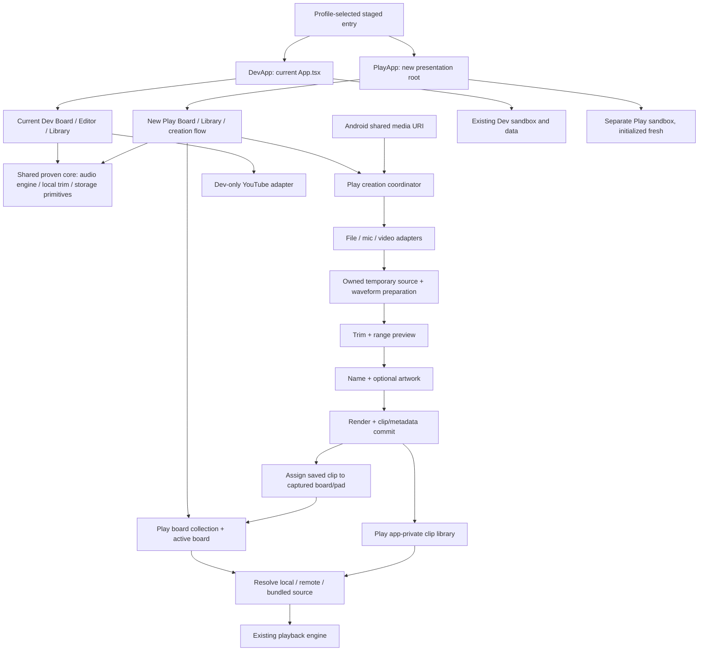

# Stimmyz design implementation plan

Date: 2026-10-17. Status: partial implementation in the separate `app-play/` workspace; unsigned ARM64 APK/AAB build and source/artifact audits pass. Physical-device and coinstallation acceptance remain open.

## First implementation slice

The user's separate-folder requirement supersedes the earlier proposed
`app-client/src/play/` paths below: Play has its own `app-play/index.ts`,
`App.tsx`, configuration, UI and persistence. The Dev app's tracked files remain
unchanged. Selected leaf audio/PCM/validation/keyboard helpers are reused through
an explicit allowlist; Play does not import the Dev root, source defaults or
extraction adapters. The build script stages only reviewed Play inputs and those
shared files.

Implemented so far: the separate Play app/package root, stage validation,
empty named boards with persisted selection, Play-only Library and snapshot
recovery, basic themes, Board/Editor/Library UI, local audio-file preparation,
range trimming/preview, Fine tune, icon/color/name customization, save and
captured-pad assignment/retry. This partially covers D1–D5. The 30 Play
data/media tests, six stage/plugin tests and TypeScript check pass. Yarn 4.18
immutable install passes in isolated Linux storage. The Dev baseline passes 124
tests and TypeScript; all 102 tracked `app-client/` files match their captured
pre-change SHA-256 baseline. The Play native build and extractor/signature/
alignment audits pass: unsigned ARM64 testing APK (39,360,002 bytes) and AAB
(30,387,537 bytes), package `dev.sarunas.soundboard.play` 1.0.0/code 1. Neither
artifact was signed, installed or published; physical-device interaction,
coinstallation, and full release/privacy acceptance remain open. Recording,
video/share ingestion, gallery artwork, reorder/move UI, resilient draft
restoration, and backup/export/import remain pending. See the [verification
record](play-verification-2026-10-17.md), [STEPS.md](../STEPS.md), and
[app-play/README.md](../app-play/README.md).

This plan turns the new design handoff into repository-specific work. Keep the
current private sideload app as the Dev app, including its package identity,
signing identity, data, YouTube extraction, and current UI and editor flow.
Create a separate Play app from the same repository, using shared proven core
where practical and a distinct presentation and packaging root. The handoff's
new UI and features target Play; they do not imply a Dev redesign. This plan
does not authorize a release, installation, or deployment. Existing L-series
acceptance items remain open.

## Design inputs and provenance

Current source: the reviewed bundle imported unchanged from
`C:\Users\Sarunas\Downloads\StimmyzApp_Astra_Handoff_Reviewed_2026-10-17.zip`
(5,454,486 bytes; SHA-256
`4E4773D27D6605CC14C80854A0488FE4B8889269EB0A6338F450A822587EEC6E`) into
[design/reviewed-2026-10-17](design/reviewed-2026-10-17/). It contains 20 files,
including the revised handoff and `RESEARCH_AUDIT_2026-10-17.md`. The earlier
bundle at [design/StimmyzApp_Astra_Handoff](design/StimmyzApp_Astra_Handoff/)
is retained as historical; do not use conflicting claims in it as current
requirements. The prototype and token files are byte-identical to the earlier
bundle.

- [Current handoff](design/reviewed-2026-10-17/ASTRA_HANDOFF.md): product behavior and A–G phases.
- [Research audit](design/reviewed-2026-10-17/RESEARCH_AUDIT_2026-10-17.md): updated market and legal/policy research; recommendations to verify, not legal conclusions or repository verification.
- [Offline HTML prototype](design/reviewed-2026-10-17/design/prototype.html): interaction reference; media operations are simulated.
- [Theme tokens](design/reviewed-2026-10-17/design/tokens.json): proposed colors and sizing.
- [Eight previews](design/reviewed-2026-10-17/design/previews/) and
  [current screenshots](design/reviewed-2026-10-17/references/current/): reviewed visually.
- [STEPS.md](../STEPS.md), [README.md](../README.md), [PLAN.md](../PLAN.md),
  and the current source: existing behavior and implementation evidence.

The bundled concepts and demo names/images are design references, not production
assets. Neither the prototype nor its mock online search becomes app code.

## Priority and evidence boundaries

Use the reviewed research audit as a product and verification checklist, not as
legal advice or a finding that either app is compliant. Before a public test,
verify current primary policy sources, inventory every bundled or remotely
preloaded Dev sound and every Play-shipped asset, document source/licensing
provenance, and reconcile actual SDK/network/microphone behavior with the Play
Data Safety form and public privacy policy. Do not imply that personal-build
YouTube use is authorized. Do not make uniqueness claims for trimming, boards,
artwork or offline playback; test the positioning hypothesis with users.

Priorities follow the reviewed audit: P0 is a fast, reliable local audio/video
and microphone create-to-play path, safe URI handling and small-screen/cancel
behavior, empty or rights-reviewed starter content, plus the rights and privacy
gates above. P1 follows once creation works smoothly: media share, gallery art,
backup/export/import, visible Quick add configuration, and board/clip menus.
P2 is online image search, licensed packs, and public board sharing; public
sharing requires a moderation/report/takedown plan. Keep the implemented basic
themes, but do not spend the next slice on elaborate visual polish ahead of
creation, retention and recovery.

## What the repository actually has

| Area | Verified current implementation | Required change |
| --- | --- | --- |
| Runtime/navigation | Expo SDK 57, React Native 0.86, React 19; Dev `app-client/index.ts` imports `./App`; Play now has separate `app-play/index.ts` and `App.tsx` | Keep distinct roots and share proven leaf core only; no web rewrite |
| Board | Dev has one `board.json` v1 snapshot; Play has a separate persisted collection of named boards with empty pads | Finish Play reorder/move UI and actions; keep Dev board model and behavior intact |
| Defaults | Dev first 16 pads resolve five remote manifest sounds and 11 bundled assets; local overlay can replace defaults | Preserve Dev source resolution and caching. Play starts without automatic remote defaults or unreviewed bundled sounds; add only reviewed licensed defaults later |
| Library | Dev's `local-clips/catalog.json` v1; Play has private catalog/audio, snapshot recovery and optional icon/color presentation | Add gallery artwork and resilient backup/export/import for Play; retain Dev behavior and core compatibility |
| Editing | Dev `EditorScreen.tsx` owns device-file and service/native-YouTube sessions; Play has local file preparation, waveform, preview, render, name/art customization and save/assign/retry | Keep Dev flow; complete Play video/mic sources, robust interruption handling and retention |
| Audio | `src/audio/engine.ts` plays pads through the existing warm/cache path; `onPressIn` triggers playback | Keep engine and immediate playback; artwork/menu rendering must not delay taps |
| Imports | Dev supports local audio with 5-minute / 32 MiB source cap; Play's first local-file path trims to 60 seconds and saves PCM16 WAV | P0: validate URI/lifecycle UX, add local video and microphone; P1: Android media share |
| Distributions | Dev ordinary/prototype/private configs; Play has distinct `app-play/` identity and staged extractor-free source allowlist | Complete native Android settings and produce/inspect APK + AAB; ordinary is not a verified store build |
| Presentation | Dev safe-area/reorder/keyboard and existing Editor/Library remain intact; Play has basic themes and Board/Editor/Library screens | Keep Play basics; prioritize creation, retention and recovery before theme polish; add missing menus/reorder as P1 |

Multiple boards were reported in the handoff; Play now implements named boards,
though reorder/move controls remain pending.
The current private source profile is the Dev app: package
`dev.sarunas.soundboard.sideload`, version 1.0.3/code 4. L18 records its
2026-10-16 phone update; the older handoff's 1.0.1/code 2 description is
historical. Device state has not been queried for this planning task. L9 and
L15–L17 retain their pending checks; L18 does not close them. Historical test
counts are evidence from those changes, not a fresh run. Play uses application
ID `dev.sarunas.soundboard.play`; its distinct package config is intended to
allow coinstallation and separate private data sandboxes, subject to physical
verification. No Dev-to-Play data transfer is planned.

## Proposed architecture



`app-client/index.ts` imports `./App` for Dev; `app-play/index.ts` is the Play
entry. Keep the current Dev composition and screens intact as the baseline.
The existing Play build script stages its own root and reviewed shared files;
resolve the remaining Gradle settings-stage blocker before claiming a native
artifact. New presentation belongs under a Play root;
extract shared engine, trim, file and persistence helpers only where their
behavior remains covered by Dev regression checks. Keep UI steps separate from
Play media operation state. A draft captures origin page,
optional target board/pad, source ownership, integer range offsets, name, artwork
and operation generation. It transitions through source/preparing/trimming/
customizing/saving/success, with explicit recording, cancel, discard and error
states. Only the coordinator owns cancellation and temporary-file disposal.

Continue validates the selected range and opens Customize. Save renders the
current validated range and commits it once; a reusable matching scratch render
may be kept. Returning to Trim preserves the draft; changing the range invalidates
the old render. Changing only name/artwork never re-extracts audio. Re-editing a
saved clip trims the saved audio and creates a new clip by default: original
masters are not retained and must not be assumed available.

No navigation package rewrite is needed initially. Use the existing shell plus
a full-screen creation presentation with native Back handling, internal scroll,
safe-area-aware actions, focus restoration and the existing keyboard helpers.

## Data and migration decisions

1. **Shared code, separate app data.** Reuse proven storage and media code where
   practical, but Dev and Play have different Android package IDs and separate
   app-private libraries. Keep Dev UUIDs, filenames, legacy missing-extension
   behavior (`m4a`), creation dates and source resolution. Play initializes
   with an empty library and no automatic Dev read/copy/import. Board creation,
   move, rename, theme and artwork changes never copy audio.
2. **Play board collection.** Introduce a versioned Play collection with stable
   board IDs, names, active ID, stable per-board slots, visual order and pad
   overrides. Dev remains on its current snapshot and UI unless a later
   explicitly scoped upgrade is approved. Existing v1 snapshots are fixtures
   for shared-core compatibility and an optional future Dev upgrade, not a
   migration source for Play or a prerequisite to launch it. Play's initial
   board starts empty. Play references explicitly identify a local clip UUID or
   an approved Play source ID. If Play later ships licensed defaults, add them
   through a reviewed Play source catalog. Do not import Dev's current source
   set. For Dev compatibility only, identify a legacy base source by stable
   slot index (0–15), not manifest pad ID: `loadManifestPads()` can replace
   that ID by grid position. Resolve current Dev IDs/URIs through the stable
   base slot.
3. **Separate empty from default.** In Dev, the legacy null overlay means use
   the original sound for the first 16 slots; appended null slots are currently
   omitted. Shared-core readers and any optional Dev upgrade must retain that
   interpretation. Play uses an explicit empty state and does not inherit Dev's
   16 defaults. Never reinterpret old Dev nulls as empty. Fresh Play slot states
   are `empty` or `assigned(source)`; a future reviewed curated-default design
   may add an explicit Play-default state. Preserve legacy omitted appended gaps
   only in Dev compatibility handling; explicitly created Play empty pads stay
   visible after restart. Play Clear leaves an empty slot. Dev's current remove action
   still restores the original first-16 sound and its confirmation says so. Do
   not add a Dev reset feature as part of Play work.
4. **Pad label versus clip name.** Recommend an optional board-specific label
   override. Library Rename remains a shared title change; pads without an
   override follow it. A pad override takes precedence and can be reset.
5. **Artwork is optional shared clip metadata.** Extend the versioned catalog
   reader/writer together; accept v1 records with no artwork. Store validated,
   bounded local thumbnail paths/IDs in an app-owned artwork directory; use
   built-in icon/color IDs for defaults. An art edit affects all uses of that
   clip, without audio rendering. Do not persist external picker URIs as the only
   offline image source.
6. **Crash-safe Play writes; optional Dev compatibility.** Stage and validate
   each Play snapshot before promotion. Existing Dev v1 primary/backup behavior
   stays covered by compatibility fixtures. Any future Dev schema migration is
   a separate, opt-in plan: validate both snapshots, preserve a v1 recovery copy,
   make retries idempotent, and show recovery feedback if both copies are corrupt.
   Do not run such a migration on real Dev data for Play or assume an older APK
   understands a future schema.
7. **Clip commit and assignment are separate recoverable steps.** Stage audio/art
   before catalog promotion and roll back uncommitted owned files. Once a clip is
   durably saved, failed target assignment keeps it in Library and offers retry;
   retry cannot create another clip. Resolve the captured board/pad, not whatever
   board happens to be active after asynchronous processing. Never overwrite a
   concurrently changed target without confirmation.
8. **Play cross-board deletion and moves.** Count all references for delete warnings;
   clear references across all boards before final clip-file deletion, with
   recovery for partial writes. Prefer one board collection snapshot for moves:
   commit destination and source changes together. Proposed Move semantics:
   choose a destination board and slot (free slot/append suggested), confirm
   occupied replacement, then transfer the displayed source reference and label/
   color overrides. The source becomes explicitly empty; confirmation explains
   this. Play starts without inherited original defaults, so no reset-to-Dev
   sound behavior is implied.
   A failed/full destination leaves the source unchanged. Add to board from
   Library is the separate operation for keeping the same clip on both boards.
   Deleting a board or clearing a pad keeps Library audio/art.
   Artwork cleanup must account for current and recovery metadata references.

Keep the existing 1,000-clip library and 1,000-pad per-board limits initially;
choose a bounded board-count policy during the schema increment. Do not silently
introduce unlimited decoded buffers or preload every board.

## Implementation order and file ownership

Existing paths below are relative to the repository root. New filenames are
proposed implementation locations, not claims that those files exist.

### D1 — Baseline and distribution boundary (handoff A)

| Files | Work |
| --- | --- |
| Existing `app-client/index.ts` → `./App` stays Dev; `app-play/index.ts`, `app-play/App.tsx`, `app-play/app.json`, `app-play/package.json` are Play | Separate entrypoints and isolated stages; Play label Stimmyz, application ID `dev.sarunas.soundboard.play`, independent versioning/signing configuration; do not rename the installed Dev app or change its update identity. `app-client/app.json` is common Dev config: keep its changes out of Play-only permission/theme work. Source staging and unsigned APK/AAB builds pass; physical-device and coinstallation checks remain |
| `app-client/modules/soundboard-youtube/android/build.gradle`, `app-client/plugins/withYoutubePrototype.js`, `app-client/plugins/withPrivateRelease.js` | Preserve extractor in Dev/prototype; omit the entire YouTube module and extractor-specific code/resources from Play stage and build graph, including disabled native stub |
| Existing `app-play/` root; `app-play/plugins/withPlayRelease.js`; reviewed shared leaf files staged by `scripts/build-play-android.ps1` | Keep current Dev screens and flow; Play entry graph contains no YouTube UI, adapter, API extraction path, strings, assets or native module; avoid runtime feature toggles as the boundary. `scripts/verify-play-stage.mjs` enforces the reviewed stage boundary |
| Existing `scripts/build-private-apk.ps1`; `scripts/build-play-android.ps1`, `scripts/verify-play-stage.mjs`, `scripts/play-release-plugin.test.cjs` | Preserve Dev release checks; Play stage/plugin checks, unsigned testing APK and unsigned AAB builds pass. Keep physical install/coinstallation and device behavior as unverified acceptance items |

Record Dev fixture snapshots and baseline app/type/native results before
changing shared code. Keep its existing package `dev.sarunas.soundboard.sideload`,
signing identity, data sandbox, YouTube behavior, UI and editor flow intact. The
Play package must be coinstallable and use independent versioning/signing; do
not read, copy or migrate Dev's private data into Play. Build both roots from
isolated source stages. Inspect Play dependency graph, autolinking, merged
manifest, DEX/classes, native libraries, JS bundle, strings and assets. The Play
root must not import Dev `PADS`/manifest defaults, package current bundled
comparison sounds, or include illustrative prototype media unless license and
inclusion are explicitly reviewed.
Absence of `yt-dlp` alone is insufficient. Do not ban shared audio decoder
libraries just because FFmpeg is also used for extraction: trace their purpose
and dependencies. Repeat artifact inspection after later native/profile changes.

**Build/source exit:** Play has no extraction functionality or YouTube-specific
path and starts with an empty Library and board (licensed curated defaults may
be added after review); Dev still has its existing extraction, import, editor
and playback behavior. Stage, extractor audit, unsigned ARM64 testing APK and
unsigned AAB are verified in the [verification record](play-verification-2026-10-17.md).
Physical installation, side-by-side operation, and separate on-device data
remain unchecked. This establishes packaging, not store publication readiness.

### D2 — Board and catalog foundations (handoff A/E, brought forward)

| Files | Work |
| --- | --- |
| Existing `app-play/src/data/boardModel.ts`, `boards.ts`, `catalog.ts`, `library.ts`, `snapshot.ts` | Play named-board collection, explicit empty/source semantics, active board and private catalog/snapshot recovery are implemented; finish remaining retention and board actions without changing Dev storage |
| Existing `app-play/src/ui/BoardScreen.tsx`, `LibraryScreen.tsx`; proposed Play board/pad menus and reorder/move controls | Add target-board/pad selection, reorder and cross-board move UI in Play; do not treat Dev `PadPicker.tsx` or `search.ts` as Play paths |
| Existing Play catalog/storage and tests; Dev `app-client/src/editor/catalog.ts`, `library.ts` only for regression-safe shared-core extraction | Add optional gallery artwork and backup/export/import; preserve Dev sandbox and do not copy real Dev data into Play |
| Existing Play data/media tests and Dev baseline fixtures | Keep Dev compatibility coverage; Play empty initialization, explicit empty/source semantics, active selection, retry and write-failure checks; no Dev-to-Play migration |

**Exit:** Play creates/switches/restarts boards and moves/deletes references
without duplicating or deleting shared audio. Dev v1 fixtures remain readable
and current Dev storage behavior remains covered. Optional v1-to-v2 Dev upgrade
logic is not needed for Play and must not be run against the installed Dev data
as part of this initiative.

### D3 — Play theme and main-screen design (handoff E)

| Files | Work |
| --- | --- |
| Existing `app-play/App.tsx`, `app-play/src/ui/theme.ts`; current `app-client/App.tsx` stays Dev | Basic Play dark/light/system theme support is implemented; complete persisted preference and system-bar details only as needed. Native prebuild reports `expo-system-ui` is needed for global Android interface style; verify theme and picker behavior on device. Avoid common `app.json` changes that alter Dev appearance or permissions |
| Existing `app-play/src/ui/BoardScreen.tsx`; proposed Play pad menus, board selector actions, and reorder/move controls | Board rendering and named boards exist; add missing menus, visible Quick Add preference and reorder/move actions in Play. Do not extract/rewrite Dev Board unless needed for shared logic |
| Existing `app-play/src/ui/LibraryScreen.tsx`; proposed Play menu/sorting/settings affordances | Library UI exists; finish preview/menu actions and Newest/A–Z/Duration sorting. Prioritize creation and recovery over elaborate themes |

Preserve `onPressIn`, warm/cache behavior, stop/progress, drag/edge-scroll and
tap-to-move alternatives. Menu presses must not trigger audio or drag. Move
technical diagnostics away from the main header while retaining error feedback.

Quick add is an additional affordance or explicit empty slot, never a replacement
for pad 16. Start with Choose file as the proposed default; Record becomes a
selectable default once D6 is available. Preferences have a visible accessible
menu, not only long press. Sorting is opt-in and never changes board order.

**Exit:** Play theme and active board persist; Play screens and pickers respect
system bars and theme on device; Dev presentation, source resolution,
assignments and playback remain unchanged.

### D4 — Play Source → Trim → Customize flow (handoff B/C)

| Files | Work |
| --- | --- |
| Existing `app-play/src/ui/CreateFlow.tsx`, `EditorScreen.tsx`; proposed draft-restoration module if needed | Local-file preparation, trim/preview, name/icon/color, save/assign and retry exist. Add robust draft/Back/cancel/interruption behavior; cancel currently discards the draft |
| Existing `app-play/src/media/localAudio.ts`; selectively shared Dev `app-client/src/editor/localAudio.ts` and playback helpers only when regression-safe | Keep Dev `EditorScreen.tsx`, `onDeviceYoutube.ts` and `api.ts` as the existing flow; reuse media operations behind a stable core boundary |
| Existing `app-play/src/ui/Waveform.tsx`; proposed refinements in `CreateFlow.tsx` and `EditorScreen.tsx` | Existing range trim and Fine tune; ensure source URI lifecycle, preview cursor/range invalidation, compact layout and keyboard safety |
| Existing Play Board/Library screens and data/media tests | Connect every Play entry and captured target; hide Play navigation during creation; add tests for stale completion, duplicate save, cancel, recovery and retry |

Keep integer milliseconds/sample positions and the current valid minimum range;
retain 60 seconds maximum and 100-character nonblank names. Fine tune changes
by 100 ms / 1 s and clamps identically to drag. On narrow displays regroup
controls so labels remain intact and targets reach 48 dp; do not copy the tiny
prototype buttons literally. Customize allows saving without artwork from day one.

Retain drafts across foreground interruptions/rotation where feasible; restore
bounded metadata after process death only if owned temporary media still exists.
Missing media offers recovery instead of promising unsupported restoration.
Re-edit opens the saved clip with copy-on-save semantics. Final discard/save
cleans up only draft-owned files and cancels stale operations.

**Exit:** one Play flow works from every Play entry; Back retains range/name;
cancel/error/double Save cannot lose a clip or create duplicates; assignment
failure still leaves one playable Play Library clip. Dev Editor behavior remains
available and passes regression checks.

### D5 — Play local artwork (handoff E)

| Files | Work |
| --- | --- |
| Proposed `app-play/src/ui/ArtworkPicker.tsx` (or equivalent), crop UI, storage and validation; Play package/config only | Audit SDK-compatible picker/image APIs, then add gallery import, bounded square crop/reposition/encode and local thumbnail storage; gallery is not implemented yet |
| Play `CustomizeStep`, Board `PadTile`, Library; shared `catalog.ts`/`library.ts` only with v1-compatible optional fields | Live labeled preview, default icon/color, gallery, later Change artwork; preserve no-art and missing-art fallbacks without adding Dev artwork UI |
| New Play artwork/storage tests and catalog compatibility fixtures | Oversized/invalid images, canceled picker, missing image, write failure, replacement cleanup and offline restart; existing Dev catalog remains readable |

Use app-owned or licensed built-ins. No online search entry should imply a working
provider before D8. Generate small bounded thumbnails outside pad playback; do
not decode full-resolution gallery images for every pad.

**Exit:** thumbnails persist offline; skip/cancel artwork still permits audio
save; changing art leaves audio bytes and clip IDs unchanged.

### D6 — Play recording, video and Android share ingestion (handoff D)

| Files | Work |
| --- | --- |
| Proposed `app-play/src/media/recording.ts`; selectively shared `app-play/src/media/localAudio.ts` boundary | P0: Play foreground recording with contextual permission, timer, stop/cancel/interruption; feed owned media into existing preparation/trim |
| Proposed Play media module only if the API spike requires native code; Play video adapter | P0: validate local video, select/decode its audio track on-device, produce compatible working media and waveform without server conversion |
| Proposed Play media-share plugin and `app-play/src/media/shareInbox.ts`, native module if needed | P1: handle cold/warm `ACTION_SEND` with read-granted `content://` audio/video; stage promptly, deduplicate deliveries and queue/confirm when another draft is active |
| `app-play/app.json`, `app-play/plugins/withPlayRelease.js`, Play-only build scripts/tests | Add `RECORD_AUDIO` only to Play when enabled; leave Dev's existing blocked permission policy and `withPrivateRelease.js` unchanged; retain unrelated storage-permission restrictions. Current Play APK inspection reports no microphone or broad storage/media-read permission |

Prioritize local video and recording as P0; media share is P1 after the core
create-to-play path is reliable. First run a bounded compatibility spike for picker URI handling, recorder output,
local video audio decoding and memory usage. Read exact Expo SDK 57 docs before
coding; select dependencies after proving compatibility with the existing audio
decoder. Keep audio source limits at 5 minutes / 32 MiB and selection at 60 seconds.
Propose the same initial input caps for video; explicitly revisit them if common
videos exceed 32 MiB. Do not silently raise limits or decode unbounded media.

Reject unsupported/no-audio/corrupt files with actionable feedback. Shared text
links are not media imports. Copy granted media into owned cache while access is
valid; never require a raw filesystem path or broad storage permission. Recording
stops on cancel/background/interruption with defined recovery and no background
capture. Native work must remain independent of the YouTube module in Play.

**Exit:** P0 microphone and supported video produce a playable offline clip;
permission denial, interrupted preparation, low storage and cancel leave existing
media untouched and no partial committed clip. P1 shared media has a separate
acceptance check for read grants, lifecycle and duplicate delivery.

### D7 — Dev/Play integration QA (handoff G)

Update app test registration, release documentation and artifact checks as files
are added. Run focused tests per increment, then combined shared-core and
profile-root suites plus TypeScript checks. Build Dev and Play artifacts from
isolated source stages; repeat Play extractor exclusion and profile-specific
merged-permission checks. The current unsigned Play ARM64 APK/AAB and extractor,
signature-absence and 16 KiB ZIP-alignment checks pass (see the [verification
record](play-verification-2026-10-17.md)). Do not publish or install them as part
of this plan.

Use a fixture-filled test package/device first for Play storage/failure checks.
Verify Dev's `dev.sarunas.soundboard.sideload` identity, signing configuration,
UI, YouTube flow and data behavior remain unchanged. Verify Play's separate
application ID, independent versioning/signing configuration and sandbox allow
coinstallation; confirm Play initializes empty without copying Dev data. A
later Dev update must keep its existing package and signing identity and use a
monotonically higher version code. Never uninstall or clear the user's Dev data.

**Exit:** the acceptance matrix below has recorded results, including remaining
limitations. Finish applicable older L-series checks separately. Before any
public test, verify current primary policy sources, inventory every bundled or
remote Dev sound and every Play-shipped asset, document provenance, and reconcile
SDK/network/microphone behavior with the Play Data Safety form and public privacy
policy. Research-audit legal statements are verification prompts, not legal
conclusions. Packaging success alone does not close these gates.

### D8 — Online artwork search (handoff F)

The user selected Imgflip on 2026-10-18. Play now uses its free popular-template
endpoint with local name filtering; full-catalog search is a paid API feature
and is excluded. No API key is needed for this endpoint. Optional selection
creates a private bounded JPEG thumbnail and stores the template source URL.
Picker errors/cancellation preserve the audio draft and default icon/color.
Gallery import, manual crop/reposition, and later artwork replacement for saved
clips remain pending. No third-party meme images are bundled. Imgflip permits
API image downloads; underlying content rights remain with their owners:
[API documentation](https://imgflip.com/api), [terms](https://imgflip.com/terms).

### D9 — Play backup, export and import (P1)

Add a user-controlled Play backup/export format for board collections, clip
metadata and owned media, with bounded archive size, schema/version validation,
integrity checks and safe temporary extraction. Import must preview conflicts,
avoid overwriting current data silently, preserve board/source identity where
possible, and recover cleanly from cancel, corrupt archives, low storage and
interrupted writes. Keep this entirely within Play's sandbox; it is not a Dev
data migration path. Test round trips, duplicate clips, missing media and
interrupted export/import before release.

## Verification and acceptance

The repository uses Docker tooling. The Play JS suites, TypeScript check and
stage/plugin checks have passed in the current implementation snapshot (see the
first-slice status above). Use these commands to reproduce them; native and
device acceptance remains pending:

```powershell
# Play JS checks in the supported tools container.
docker compose --profile tools run --rm --no-deps --entrypoint /bin/sh deps -lc 'corepack enable && yarn workspace app-play test && yarn workspace app-play check'
# Play stage boundary (already passing in this snapshot).
.\scripts\build-play-android.ps1 -StageOnly
# Native unsigned ARM64 artifact pipeline (passed; see linked verification record).
.\scripts\build-play-android.ps1
# Dev-only baseline/build commands; these do not validate the Play package.
.\sb.ps1 apk --all-abis
.\scripts\build-private-apk.ps1
```

Run affected Kotlin tests with the relevant profile, plus the release-profile
suite. No backend deployment is required; test the existing service-backed
personal adapter if its boundary changes.

| Acceptance area | Required evidence |
| --- | --- |
| Dev preservation and Play isolation | Dev retains package/signing/data identity, current UI, YouTube and existing flows; Play has separate package/version/signing/data, starts empty and never reads/copies Dev sandbox |
| Core compatibility | Dev v1 with/without order, legacy extensions, appended/duplicate/missing clips; corrupt primary/valid backup, both corrupt, interruption/repeat fixtures; IDs/audio hashes/defaults unchanged. These are compatibility tests, not Dev-to-Play migration |
| Play boards | Create/switch/relaunch, independent order, shared local refs, only explicitly added reviewed sources/defaults, active-board restoration; move/replace/full-target failure does not lose source |
| Play pad/Library actions | Pad override versus shared rename; empty clear; remove board preserves files; Library delete warns and clears every Play board reference |
| Play creation | Board/Editor/Library/empty/Replace/re-edit entry; captured target remains stable; drag and nudges agree; Back/discard, stale async completion, duplicate Save and assignment retry |
| Playback | Dev existing local/remote/bundled behavior and Play local behavior, immediate press, stop/progress/prewarm; no audible menu activation; compare physical-device timing before/after on matching conditions |
| Native sources | MP3/M4A/WAV/AAC plus supported video; recorder denial/interruption; cold/warm share URI; no-audio/bad codec/size/duration/storage errors; originals untouched |
| Play backup/recovery | Export/import round trip; corrupt/oversized archive; conflicts, duplicates, missing media, cancellation, low storage and interrupted writes; no Dev sandbox access |
| Offline | Standalone release cold launch after force-stop in airplane mode; saved local clip/art/boards work without Metro/API; remote cache misses remain distinct |
| Accessibility/layout | Compact and large Android devices, 200% text, TalkBack, hardware Back, keyboard already open, rotation, dark/light/system, reduced motion, button/gesture navigation |
| Visual details | Menu surfaces opaque/legible; minimum target sizes; pads adapt column count as needed; light theme follows semantic tokens rather than the captured preview's dark-looking canvas |
| Packaging/upgrade | Inspect Dev and Play artifacts separately; Play testing APK + unsigned AAB contain no extractor paths; only Play gets contextual mic permission; verify coinstallation and independent versions/data; same-identity Dev update preserves data |
| Capacity/resources | 1,000 library entries/pads, several boards, thumbnail memory and list responsiveness; visible-row prewarm only; no unnecessary audio copies |

## Defaults and decisions to confirm before their implementation

Planning can proceed with these recommendations; they are not silently treated
as existing behavior or an instruction to begin coding:

- Pad Rename changes a board-specific label; Library Rename changes the shared title.
- Play starts with an empty Library and board; any licensed curated defaults require a later explicit review. Dev retains its current defaults and clear behavior.
- Quick add initially chooses a file; its visible menu can change the preference.
- Online artwork search and optional accent customization follow the core release.
- Keep the existing private Dev identity; Play is currently configured with
  application ID `dev.sarunas.soundboard.play` (confirm before release). Keep Dev's current UI,
  flows and data sandbox independent from Play. Confirm brand spelling: source uses **StimyzApp**,
  handoff title uses **StimmyzApp**, and mock screens use **Stimmyz**.
- Confirm Play board count/naming limits and Move-to-board destination behavior in D2;
  confirm video caps and supported codecs after the D6 spike.

Recommended next order follows the reviewed audit while preserving milestone
IDs: D1's unsigned ARM64 Play APK/AAB and extractor audit are complete at build
level; retain physical-device/coinstallation checks in D7. Next finish P0 D4
create-to-play reliability and D6 video/microphone sources, alongside D7's
rights inventory and primary-source privacy/Data Safety verification before any
public test. Next do
P1 D6 media share, D5 gallery art, D9 backup/export/import, and D3 visible Quick
Add/menus/reorder. Leave P2 D8 online search, licensed packs and any public
sharing until rights, provider and moderation decisions are verified. Existing
basic themes stay; elaborate theme work does not outrank creation, retention or
recovery.
